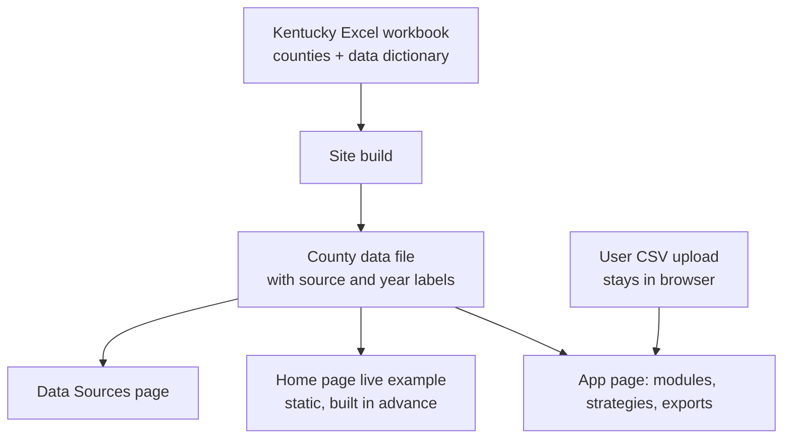

# NourishScope Tech Stack

## Summary

NourishScope v1.0 is built as a static Astro site. Content pages are written in Markdown and ship as plain HTML. The `/app` page is the only page that loads code, and that code is written in TypeScript. The Kentucky Excel workbook is the single master copy of the data and is converted into a data file at build time. The site deploys to free static hosting with no server, and Moses maintains it.

---

## Problem Frame

NourishScope is a student's class project. The brief describes about ten content pages (Home, Methodology, Data Sources, About, Research, Changelog/Cite, Privacy, Accessibility, Terms, Contact) and one interactive planning tool. Its users are Extension agents, public health staff and food banks. Many of them work in rural Kentucky on slow connections and phones.

The brief sets hard limits: free to use, all data stays in the browser, WCAG 2.1 AA, and fast on slow connections. Moses builds and maintains the code, and the student supplies page text and decisions. The stack should match that shape: mostly content, one tool, one maintainer, and a yearly data refresh.

---

## Key Decisions

- **Astro static site over a React single-page app.** Content pages render to HTML that needs no JavaScript, so they load fast on rural connections. Each page has its own title and URL, which keeps accessibility straightforward. The cost is learning one new tool. A React single-page app would make even the Privacy page wait for the whole app's code to download.
- **Interactive code only on the app page.** The calculations, CSV upload, county matching, labeled sample data, evaluation module, charts and exports load only on `/app`. Other pages stay static.
- **The Excel workbook is the single master copy.** `NourishScope_Kentucky_County_Dataset_v1.0.xlsx` (both sheets) is converted to a data file during each build. It holds the same 120 counties as `nourishscope_ky_counties_v1.0.csv` plus the `Data_Dictionary`, so it is the most complete form of the data and replaces the CSV that the calculation spec names. The site never reads the Excel file in the browser.
- **The calculation spec defines every formula.** `NourishScope_Calculation_Specification.docx` (Methodology v1.0) is the authority for inputs, defaults, strategies, sensitivity, equity flags, exports and evaluation. The app's results must match `nourishscope_calc_reference.py` exactly.
- **Unmatched upload rows are flagged, not added.** The spec adds unmatched rows as new communities. NourishScope is Kentucky-only, so rows that match no county are flagged for the user to fix instead.
- **The PDF brief uses the browser's print-to-PDF.** A print stylesheet formats the planning brief, so no PDF library ships to users. The tradeoff is that saving as PDF is harder to find on phones, so the app gives phone users a short instruction. The CSV export is generated in the browser.
- **No server.** No backend, database or user accounts. Request a Demo is an email link.
- **Python in the browser was rejected.** Shinylive and stlite download 10–30 MB before the page appears, which rules them out for slow connections.

---

## Requirements

**Speed and delivery**
- R1. Content pages load and display with no JavaScript.
- R2. The app's code loads only on the app page.
- R3. The site deploys as static files to a free host and works at phone width.
- R17. The Home page live example and the Data Sources table are rendered at build time from the county data file as static HTML, and the Home example links to `/app` instead of loading app code.
- R18. The `/app` page's JavaScript, including any chart, CSV and UI libraries, stays at or under 150 KB gzipped and is usable within 5 seconds on simulated Slow 3G, checked before each release.
- R19. `/app` ships a static shell with a visible loading message, a no-JavaScript message that points to the Methodology page and the CSV template, and a retry message if the app code fails to load.

**Data pipeline**
- R4. The Excel workbook is the only master copy of the Kentucky data; nothing else is edited by hand.
- R5. Each build turns the `Kentucky_Counties` and `Data_Dictionary` sheets into a data file that ships with the site, mapping each workbook column to a stable, year-free field key (for example `arc_status` or `poverty_rate`).
- R20. The `Data_Dictionary` sheet gains `source_label` and `data_year` columns, which are the only source of the "Source: X, YEAR" labels, and the build fails if either is empty for a public field.
- R6. The build fails if the workbook doesn't have 120 counties or if any stable field key can't be mapped to a workbook column.
- R7. A blank cell is allowed only in `grocery_stores_per_1000` (read as "suppressed by source") and in the ARC status column where `appalachian` is No (read as "not applicable"). Any other blank fails the build, and the data file keeps both allowed states separate from zero.
- R8. The yearly refresh process ends by updating the Excel workbook, not a separate CSV.
- R21. A labeled fictional sample dataset ships with the site in the upload-template format and is clearly marked as fictional.

**App runtime**
- R9. All calculations run in the browser, and uploaded or entered data, including evaluation results, is never sent off the device.
- R10. CSV uploads are read in the browser and matched to counties by FIPS code when present, otherwise by county name, accepting variants such as "Adair", "adair county" or "ADAIR CO.". Rows that match neither are flagged for the user to fix and are never added as new communities.
- R26. When an uploaded row matches a county, its filled-in values replace the built-in values for those fields only, and blank fields keep the public data.
- R27. With built-in data and no upload, the defaults follow the calculation spec. Number of households in need defaults to SNAP households. Number of households served stays blank, so the app runs in need-only mode. Cost per household is pre-filled at $100, labeled "Example only – replace with your program's cost", and export stays blocked until the user confirms or changes it.
- R22. Upload problems are handled on the page. File-level errors are explained in plain language with a link to the template. Unmatched or ambiguous rows are listed with a county picker so the user can fix them in place. Users can continue with the matched rows while the rest stay flagged. A summary shows "N of M rows matched" before results appear.
- R23. Every figure shown in the app, the Home example, the Data Sources page, the PDF brief and the CSV export carries its source and year. Suppressed values display as "Not reported (suppressed by source)", never as zero or blank, and non-Appalachian ARC status displays as "Not applicable".
- R11. The PDF planning brief is produced through the browser's print dialog, using a print stylesheet, and contains the data sources, assumptions, date, version and chosen strategy results.
- R25. A labeled "Save planning brief as PDF" button opens the print dialog with a one-line instruction for phone users, and the print layout hides navigation and controls.
- R12. The CSV export is built in the browser.

**Content and maintenance**
- R13. Content pages are Markdown files, so student-supplied text drops in without code changes.
- R14. The version number is defined once and appears in the footer, the PDF brief, the CSV export and the Cite page.
- R15. The site meets WCAG 2.1 AA, including keyboard use and screen-reader labels on all app controls.
- R24. Every chart has an adjacent data table or text summary and never relies on colour alone, and result updates after assumption changes are announced to screen readers.

**Quality**
- R16. Automated tests reproduce the calculation spec's worked example and the reference program's outputs for every strategy, the sensitivity check and the evaluation module, and cover FIPS and county-name matching.

---

## Scope Boundaries

- Zenodo DOI. The Cite page shows the version number without a DOI.
- Internet Archive snapshots and dated launch screenshots.
- Analytics of any kind.
- A working Request a Demo form.
- Servers, databases, user accounts and login.
- States other than Kentucky.

---

## Dependencies / Assumptions

- Moses is comfortable learning Astro and writing TypeScript.
- The brief's public GitHub repository with a license still applies and is where the site is built from.
- The building machine has Node.js installed. Python stays only for the yearly refresh script.
- The yearly refresh is mostly manual. `fill_nourishscope_dataset.py` fills 7 of the 19 public data columns (Census ACS and CDC PLACES). The 10 USDA ERS columns and 2 ARC columns are downloaded and entered by hand. The CDC PLACES release stays pinned to 2024 until CDC restores the Kentucky measures.

---

## Outstanding Questions

### Deferred to Planning

- [Affects R2][Technical] Should the app page use plain TypeScript or a small UI library such as Preact or Svelte?
- [Affects R3][Technical] Which free host: GitHub Pages or Cloudflare Pages?
- [Affects R5][Technical] Should the Excel conversion run in the Node build or as a Python step next to the refresh script?
- [Affects R10][Technical] Should CSV parsing use a small library or custom code?
- [Affects R8][Technical] How should the yearly refresh change to update the workbook, cover or document the 12 hand-entered columns, keep CDC PLACES pinned to the 2024 release, and stop adding columns that aren't in v1.0?
- [Affects R16][Technical] What cent-rounding rule makes the TypeScript results match the reference program? Python's `round()` rounds exact halves to even, which differs from JavaScript's usual rounding.
- [Affects R4][Technical] Should `nourishscope_ky_counties_v1.0.csv` be generated from the workbook at build time as a readable export, or removed from the repo?

---

## Sources / Research

- `NourishScope_Website_Brief.docx`: pages, app features, data sources and technical requirements.
- `NourishScope_Kentucky_County_Dataset_v1.0.xlsx`: seed data, 120 counties by 24 columns, plus the `Data_Dictionary` sheet.
- `nourishscope_upload_template.csv`: upload columns `community_name`, `county`, `fips`, `number_of_households_in_need`, `number_of_households_served`, `cost_per_household`, and optional health and access percentages. The calculation spec calls the two household fields `households_in_need` and `households_served`, with the labels "Number of households in need" and "Number of households served".
- `NourishScope_Calculation_Specification.docx` (Methodology v1.0): inputs, defaults, the five strategies, sensitivity, equity flags, export contents, evaluation, and a worked example with Magoffin, Owsley and Wolfe counties.
- `nourishscope_calc_reference.py`: a Python reference implementation of the spec, used as the source of expected test results.
- `fill_nourishscope_dataset.py`: the yearly refresh script. It currently defaults to a missing v0.1 input and ACS year 2023, and adds columns not in v1.0.

---

## Deferred / Open Questions

### From 2026-10-12 review

- **Uploaded data and results are lost on reload with no persistence decision** — R9 / Key Decisions (P2, design-lens, confidence 75)

  With no server, no accounts and data kept in the browser, a refresh or tab discard wipes the uploaded CSV, adjusted assumptions and results. Phone browsers reload tabs on weak connections, which is the stated environment. The doc doesn't say whether in-browser state survives a reload or how users save their work, so implementers would decide ad hoc and users could end up redoing uploads and re-matching.

- **Brief requirements cut with no record of the student's sign-off** — Scope Boundaries (P2, adversarial, confidence 75)

  The Scope Boundaries cut four items from the brief's Technical Requirements (Zenodo DOI, analytics, a Request a Demo form, Internet Archive snapshots) with no reason and no note that the student agreed. The "no server" decision doesn't force these cuts, since cookie-free analytics and form services work with static hosting. If the student still expects them at launch (the brief's timeline puts analytics in weeks 6–8), there will be rework or a disagreement at delivery.
