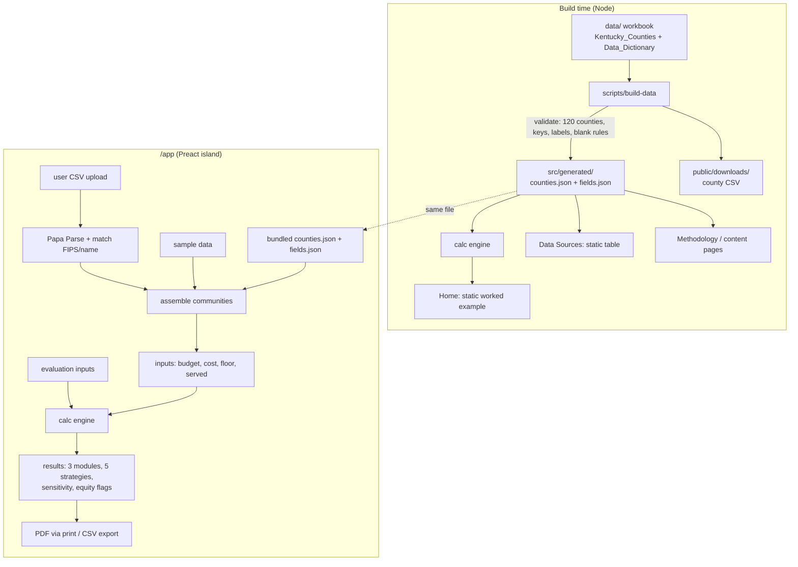

# feat: Build NourishScope v1.0 site and planning tool

## Summary

Build NourishScope v1.0 from an empty folder. It is an Astro 7 static site with Markdown content pages and one Preact-powered planning tool on `/app`. The tool runs every calculation in the founder's calculation spec on Kentucky county data that the build reads from the Excel workbook. The site deploys to GitHub Pages.

---

## Problem Frame

NourishScope is a student's class project. It is a free tool that helps Kentucky nutrition programs decide where to direct limited money. The founder's brief defines the pages and features. The calculation spec (Methodology v1.0) defines every formula, and its Python reference program gives the results the app must match. The folder currently holds only those documents, the Kentucky workbook, the upload template and a refresh script. There is no code and no git repository. Users are mostly non-specialists, often on phones and slow rural connections, so speed, plain language and accessibility shape every choice (see origin: docs/brainstorms/2026-10-12-nourishscope-tech-stack-requirements.md).

---

## Requirements

Requirements keep the origin's IDs. R28–R31 are added from the calculation spec and the brief.

**Speed and delivery**
- R1. Content pages load and display with no JavaScript.
- R2. App code loads only on `/app`.
- R3. Static deploy to a free host, and every page works at 375px width.
- R17. The Home live example and the Data Sources table are rendered at build time as static HTML.
- R18. `/app` JavaScript is at most 150 KB gzipped and usable within 5 seconds on Chrome DevTools' "Slow 3G" network preset, measured as the time until the first input accepts typing.
- R19. `/app` has a loading message, a no-JavaScript message and a retry message.

**Data pipeline**
- R4. The Excel workbook is the only hand-edited copy of the Kentucky data.
- R5. The build converts the workbook to a data file keyed by stable, year-free field keys.
- R20. The Data_Dictionary carries `source_label` and `data_year` for every public field, and the build fails if either is missing.
- R6. The build fails on a county count other than 120 or an unmappable field.
- R7. Blanks are allowed only for suppressed grocery stores and non-Appalachian ARC status. Any other blank fails the build.
- R21. Labeled fictional sample data ships with the site.

**Planning tool**
- R9. All calculation happens in the browser, and nothing users upload or type leaves the device.
- R10. Uploaded rows match counties by FIPS code first, then by county name with leeway. Unmatched rows are flagged, never added as new communities.
- R22. Upload problems are explained on the page, with a county picker, continue-with-matched, and an "N of M rows matched" summary.
- R23. Every figure shows its source and year, and suppressed or not-applicable values use fixed wording.
- R24. Charts have a data-table alternative, never rely on colour alone, and result updates are announced.
- R26. Uploaded values replace public values only for the fields the user filled in.
- R27. Built-in defaults follow the spec: need is SNAP households, served is blank, and cost is a $100 example that blocks export until confirmed.
- R28. The tool has the brief's three modules: Nutrition Program Planning, Community Health Context, and Food System and Access.
- R29. All five allocation strategies are shown side by side, with the cost sensitivity check and equity-flag shares.
- R30. The evaluation module computes change, participants improving and cost per participant improving.

**Exports**
- R11. The PDF brief comes from the browser's print dialog and contains everything listed in spec step 7.
- R25. A "Save planning brief as PDF" button opens the print dialog and includes a hint for phone users.
- R12. The CSV export is built in the browser.
- R14. One version constant feeds the footer, PDF, CSV and Cite page.

**Content and quality**
- R13. Prose pages are Markdown files.
- R15. The site meets WCAG 2.1 AA.
- R16. Tests reproduce the spec's worked example and cover FIPS and name matching.
- R31. The repository is public on GitHub, with MIT for code and CC BY 4.0 for content and data.

---

## Scope Boundaries

- Zenodo DOI, Internet Archive snapshots, analytics and a working demo form are out (see origin). Contact is an email link.
- Other states are out. Only Kentucky's 120 counties are supported.
- Saving uploads or results across reloads is out of v1.0. The app warns before the user leaves a page with unsaved work.
- Redistributing unspent funds is out, per spec step 4.

### Deferred to Follow-Up Work

- Rewrite `fill_nourishscope_dataset.py` so the yearly refresh updates the workbook (origin R8). v1.0 ships with the current data.
- Persist work across reloads in browser storage, with a "Clear my data" control.

---

## Key Technical Decisions

- **Astro 7 with static output.** Astro is at 7.x and needs Node 22.12 or later; the machine has Node 24. Static output satisfies R1 and R3. Astro 7 is newer than common examples, so check the official upgrade notes for any API you copy from older tutorials.
- **One Preact island on `/app`.** Preact adds about 4 KB and keeps a multi-step, stateful tool manageable within R18. No other page hydrates.
- **Read the workbook with `read-excel-file` at build time, not SheetJS.** The npm `xlsx` package is stuck at 0.18.5, which has known advisories (CVE-2023-30533, CVE-2024-22363). The fixed versions are only on SheetJS's CDN.
- **The Data_Dictionary sheet gains `key`, `source_label` and `data_year` columns.** The `key` column maps a year-stamped header such as `arc_status_fy2027` to a stable key such as `arc_status`. At the next refresh only the header, `field` and `data_year` change. App code never sees year-stamped names.
- **Build-time data lands in `src/generated/` and is never edited by hand.** The build also writes a downloadable `nourishscope_ky_counties_v1.0.csv` from the workbook. That CSV keeps the workbook's original column headers, so the spec and the reference program can still read it. It is git-ignored, and the Data Sources page links to it under the CC BY 4.0 data licence. The hand-kept copy at the repo root is deleted in U2, which settles the origin's open question about that file.
- **One pure-TypeScript calculation engine, used at build time and in the browser.** The Home live example is the spec's worked example, computed by the same engine during the build. Home therefore ships static numbers that are guaranteed to match the app (R17).
- **One `roundHalfEven(x, digits)` helper mirrors Python's `round()` everywhere the reference rounds.** That covers allocations, spend, unspent, coverage, change and participants improving. It decides ties from the number's exact decimal value (for example `x.toFixed(30)`), never from `x × 10^digits`. JavaScript's `toFixed` and `Math.round` round ties up and scale inexactly, so both would drift from the reference.- **CSV parsing uses Papa Parse.** It is small, handles quoted fields and Excel exports, and is cheaper to keep correct than a hand-written parser.
- **Upload headers accept both spellings.** The template uses `number_of_households_in_need` and `number_of_households_served`. The parser also accepts the spec's `households_in_need` and `households_served`. Screen labels are the spec's "Number of households in need" and "Number of households served".
- **Charts are hand-built SVG bars, with no chart library.** The tool needs only simple bar comparisons, so a library would eat the size budget without adding much.
- **Cost counts as confirmed when** the user edits the global cost, ticks "I've confirmed this cost", or every selected community has an uploaded cost. Until then, export is blocked (R27).
- **Deploy with the official `withastro/action` to GitHub Pages.** Set `site` and `base` in the Astro config so asset paths resolve under the repo path.
- **Every internal link goes through a `withBase()` helper.** The helper lives in `src/config/site.ts` and reads `import.meta.env.BASE_URL`. Astro's `base` fixes bundled assets but not hand-written hrefs. Markdown pages use relative links, so student-written text works under the repo path.
- **Licences:** MIT for code (`LICENSE`), and CC BY 4.0 for content and data (`LICENSE-CONTENT`).
- **Test-first for the engine and matching.** Vitest runs the spec's worked example as golden tests. Playwright with axe covers page-level accessibility and the key flows.

---

## High-Level Technical Design

The data flows through two stages: the build and the browser.



These are the app's modes. Each row is a combination the UI must handle.

| Served entered for every selected community? | Cost confirmed? | Coverage shown | Export enabled |
|---|---|---|---|
| No (need-only mode) | No | "—" plus a prompt to enter served | No, with a prompt to confirm the cost |
| No (need-only mode) | Yes | "—" plus a prompt to enter served | Yes |
| Yes (served mode) | No | Before and after | No, with a prompt to confirm the cost |
| Yes (served mode) | Yes | Before and after | Yes |

County matching runs in this order for each uploaded row. This is directional guidance, not code.

```text
if fips present:
    if 1–3 digits: left-pad with zeros to 3 digits, then prefix "21"   ("1" -> "21001")
    if not found in Kentucky                  -> flag "FIPS not found in Kentucky"
    else if county name present and disagrees -> flag "FIPS and county name disagree" (not matched)
    else                                      -> match
else if county name present:
    key = lowercase, strip punctuation and spaces, drop trailing "county"/"co"
    if key matches exactly one county -> match
    else -> flag "county not recognised" (offer picker)
else:
    flag "no county or FIPS given"
```

---

## Output Structure

```text
.github/workflows/deploy.yml
astro.config.mjs
package.json
tsconfig.json
vitest.config.ts
playwright.config.ts
LICENSE
LICENSE-CONTENT
README.md
data/
  NourishScope_Kentucky_County_Dataset_v1.0.xlsx
  sample/nourishscope_sample_communities.csv
docs/source/                      (brief, details doc)
reference/
  NourishScope_Calculation_Specification.docx
  nourishscope_calc_reference.py
scripts/
  add_dictionary_columns.py       (one-time workbook edit)
  build-data.ts
  check-bundle-size.ts
public/downloads/
  nourishscope_upload_template.csv
src/
  config/site.ts                  (version, methodology version, contact email, base path)
  generated/                      (build output, git-ignored)
  lib/calc/                       (validate, core, health, allocate, results, sensitivity, equity, evaluation, rounding)
  lib/data/                       (load, match, parse-upload, merge, labels)
  components/                     (Astro: Header, Footer, WorkedExample, DataSourcesTable;
                                   shared Preact SourceLabel.tsx, rendered statically on Astro pages)
  components/app/                 (Preact: App, DataSourcePicker, CountySelector, Inputs, UploadIssues,
                                   ModuleNutrition, ModuleHealth, ModuleFood, StrategyComparison,
                                   BarChart, Sensitivity, EquityFlags, Evaluation, ExportPanel)
  layouts/BaseLayout.astro, ProseLayout.astro
  pages/                          (index, app, methodology, data-sources, about, research, changelog,
                                   cite, privacy, accessibility, terms, contact)
  styles/global.css, print.css
tests/
  calc/, data/, build/, e2e/
```

---

## Implementation Units

### Phase A — Foundation

### U1. Repository, tooling and reference files

**Goal:** Create a working Astro 7 + TypeScript + Preact + Vitest project in a git repository, with licences and the founder's reference material inside it.

**Requirements:** R3, R14, R31

**Dependencies:** None

**Files:**
- Create: `package.json`, `astro.config.mjs`, `tsconfig.json`, `vitest.config.ts`, `.gitignore`, `LICENSE`, `LICENSE-CONTENT`, `README.md`, `src/config/site.ts`
- Move: `NourishScope_Kentucky_County_Dataset_v1.0.xlsx` → `data/`; both brief `.docx` files → `docs/source/`; `nourishscope_upload_template.csv` → `public/downloads/`; `fill_nourishscope_dataset.py` → `scripts/`
- Copy in: the calculation spec and `nourishscope_calc_reference.py` from the user's Downloads folder → `reference/`
- Create: `tests/calc/fixtures/reference-output.txt` (captured output of the unmodified reference program)
- Test: `tests/config/site.test.ts`

**Approach:**
- Initialise git with the default branch `main`. Git-ignore `src/generated/`, `dist/`, `node_modules/` and `public/downloads/nourishscope_ky_counties_v1.0.csv`.
- Before anything else moves, run the unmodified reference program against the original root CSV and commit its full output as `tests/calc/fixtures/reference-output.txt`. That keeps the "match the reference exactly" check possible after U2 deletes the root CSV. Moses runs this step by hand.
- `site.ts` also exports `withBase(path)`, which every internal link and download uses (see Key Technical Decisions).
- Use static output, and add the Preact integration with `npx astro add preact`. Set `site` and `base` for GitHub Pages; the repo name is still to be confirmed (see Open Questions).
- `src/config/site.ts` holds the tool version (`1.0.0`), the methodology version (`1.0`), the contact email and the base path. It is the single source of truth for R14.
- The README covers what the project is, how to build, how to refresh data, and the licences.

**Patterns to follow:** The Astro 7 project layout from the official docs.

**Test scenarios:**
- Happy path: the version constant is a semver string and the methodology version is "1.0".

**Verification:** The dev server serves a blank page, the test runner passes, and `git status` is clean after the first commit.

---

### U2. Build-time data pipeline

**Goal:** Turn the workbook into validated `counties.json` and `fields.json` files plus a downloadable CSV, with stable keys and source labels.

**Requirements:** R4, R5, R6, R7, R20, R21, R23

**Dependencies:** U1

**Files:**
- Create: `scripts/add_dictionary_columns.py`, `scripts/build-data.ts`, `data/sample/nourishscope_sample_communities.csv`, `src/lib/data/labels.ts`
- Modify: `data/NourishScope_Kentucky_County_Dataset_v1.0.xlsx` (one-time: add the `key`, `source_label` and `data_year` columns)
- Modify: `package.json` (run build-data before `astro build` and `astro dev`)
- Delete: `nourishscope_ky_counties_v1.0.csv` from the repo root, after diffing it against the generated `counties.json`
- Test: `tests/build/build-data.test.ts`, `tests/data/labels.test.ts`

**Approach:**
- The one-time Python script adds the three Data_Dictionary columns with the values below. Back up the workbook first. Open the result in Excel to confirm nothing else changed.
- `build-data.ts` reads both sheets with `read-excel-file`. It maps headers to keys through the dictionary and writes `src/generated/counties.json` (FIPS kept as a 5-character string) and `src/generated/fields.json` (key, label, pillar, `source_label`, `data_year`, description). It also writes `public/downloads/nourishscope_ky_counties_v1.0.csv`, with the workbook's original headers and with suppressed and not-applicable values as blank cells.
- Public fields are the 19 data columns. Identifiers (`county_name`, `fips`, `state`) and Data_Dictionary rows whose pillar is "User-entered" (`households_served`, `cost_per_household`) are non-public. They skip the `source_label`/`data_year` and blank-cell checks, and the two user-entered columns are left out of `counties.json` and the generated CSV.
- `src/lib/data/labels.ts` is the single owner of source-label lookup and of the fixed wording "Not reported (suppressed by source)" and "Not applicable". Every other module and component imports from it.
- Validation fails the build with a message naming the row and column for any of these: a county count other than 120, a dictionary key with no matching header, a public field missing `source_label` or `data_year`, or a blank cell outside the two allowed cases. "-9999" and "Not reported" count as blank.
- Suppressed grocery values are stored as an explicit `{ "status": "suppressed" }` marker. Non-Appalachian ARC status is stored as `{ "status": "not_applicable" }`.
- The sample CSV has five or six clearly fictional communities in the upload-template format, each mapped to a real county. Its file name and first row say "Sample data".

**Data_Dictionary values to add:**

| Workbook field | key | source_label | data_year |
|---|---|---|---|
| appalachian | appalachian | ARC | FY2027 |
| arc_status_fy2027 | arc_status | ARC | FY2027 |
| metro_nonmetro_2023 | metro_nonmetro | USDA ERS Food Environment Atlas | 2023 |
| population, total_households, snap_households, snap_household_pct | same as field | Census ACS 5-year | 2020–2024 |
| poverty_rate_2021 / child_poverty_rate_2021 / median_household_income_2021 | poverty_rate / child_poverty_rate / median_household_income | USDA ERS Food Environment Atlas | 2021 |
| persistent_poverty_2017_21 | persistent_poverty | USDA ERS Food Environment Atlas | 2017–2021 |
| diabetes_pct, obesity_pct | same | CDC PLACES | 2022 |
| high_bp_pct | same | CDC PLACES | 2021 |
| low_income_low_access_pct | same | USDA ERS Food Environment Atlas | 2019 |
| grocery_stores_per_1000 | same | USDA ERS Food Environment Atlas | 2020 |
| snap_retailers | same | USDA ERS Food Environment Atlas | 2023 |
| farmers_markets, farmers_markets_snap | same | USDA ERS Food Environment Atlas | 2018 |
| county_name, fips, state | same | U.S. Census Bureau | — (identifier) |
| households_served, cost_per_household | same | User-entered | — |

**Execution note:** Write the validation tests before the script, using small in-memory workbook fixtures.

**Test scenarios:**
- Happy path: the real workbook produces 120 counties, even though `households_served` and `cost_per_household` are blank in every row. Adair has FIPS "21001", `arc_status` "At-Risk" and `diabetes_pct` 12.1.
- Happy path: `fields.json` gives `diabetes_pct` the label "CDC PLACES" and the year "2022".
- Edge case: Anderson's blank `grocery_stores_per_1000` becomes the suppressed marker, not 0 or null. The total of suppressed markers is 42.
- Edge case: Allen's blank ARC status (it is non-Appalachian) becomes `not_applicable`.
- Error path: a fixture with 119 counties fails with a message naming the count.
- Error path: a blank `diabetes_pct` fails with a message naming the county and field.
- Error path: renaming `arc_status_fy2027` to `arc_status_fy2028` without updating the dictionary fails with "no column for key arc_status". Updating the dictionary's `field` column makes it pass.
- Error path: a public field missing `data_year` fails.
- Integration: the generated CSV round-trips to the same 120 rows and values as `counties.json`, and its headers match the original root CSV's headers minus the two user-entered columns.

**Verification:** The build writes all three outputs, and each deliberate fixture fault stops the build with a readable message.

---

### Phase B — Calculation core

### U3. Calculation engine

**Goal:** Implement every step of the calculation spec as pure, deterministic TypeScript functions that match the reference program.

**Requirements:** R9, R16, R27, R29, R30

**Dependencies:** U1, U2

**Files:**
- Create: `src/lib/calc/rounding.ts`, `validate.ts`, `core.ts`, `health.ts`, `allocate.ts`, `results.ts`, `sensitivity.ts`, `equity.ts`, `evaluation.ts`, `index.ts`
- Test: `tests/calc/rounding.test.ts`, `tests/calc/worked-example.test.ts`, `tests/calc/allocate.test.ts`, `tests/calc/core.test.ts`, `tests/calc/evaluation.test.ts`, `tests/calc/equity.test.ts`

**Approach:**
- The engine takes plain community objects (`need`, `served?`, `cost`, health measures, flags) plus budget and floor share, and returns allocations, results, totals, sensitivity and equity shares. It has no DOM or Astro imports, so the build and the browser share it.
- State medians are an input to the engine. They are always computed from all 120 counties in the generated `counties.json`, never from the selected communities, including in upload and sample modes. A test checks them against the spec's fixed values (12.3, 40.3, 36.7). The health and equity tests load the generated data.
- Every rounding step uses `roundHalfEven(x, digits)` at the same number of decimal places as the reference.
- Follow the spec exactly:
  - unmet need is `max(need − served, 0)`;
  - fall back to equal allocation when ΣU or ΣW is 0;
  - cost-effectiveness sorts by cost, then higher H, then higher U;
  - households reached are floored;
  - unspent money is reported, not redistributed;
  - coverage appears only when served is entered for every selected community.
- `validate` rejects negative or non-numeric values, names the row and field, and treats "-9999", blank and "Not reported" as missing. It warns when served exceeds need.

**Execution note:** Test-first. Transcribe the spec's worked example as golden tests before writing the engine.

**Test scenarios:**
- Happy path: for Magoffin, Owsley and Wolfe with need 1,759 / 593 / 976, served blank, cost $100 and B = $50,000:
  - H = 1.147 / 1.066 / 1.188.
  - Equal: $16,666.67 each; reached 166 / 166 / 166; unspent $200.
  - Proportional: $26,427.28 / $8,909.25 / $14,663.46; reached 264 / 89 / 146; unspent $100.
  - Need-weighted with a 5% floor: $25,939.25 / $9,297.13 / $14,763.62; reached 259 / 92 / 147.
  - Health-weighted: $26,475.74 / $8,299.53 / $15,224.74; reached 264 / 82 / 152.
  - Cost-effectiveness: $0 / $0 / $50,000; reached 0 / 0 / 500.
- Happy path: proportional sensitivity reaches 624 at −20%, 499 as entered, and 416 at +20%.
- Happy path: with served 400 / 150 / 200, proportional coverage goes from 22.5% to 37.5%.
- Happy path: evaluation with pre 30%, post 55%, 73 participants and $2,500 gives +25 points, 18.2 participants improving and $136.99 each.
- Edge case: rounding matches Python's `round()`:
  - at 2 decimals, 0.125 → 0.12, 0.375 → 0.38, 2.675 → 2.67, 0.005 → 0.01, 0.015 → 0.01, 250.025 → 250.03 and 25000.025 → 25000.03;
  - at 1 decimal, 18.25 → 18.2.
- Integration: per-community allocation, reached and spend for every strategy and sensitivity level match `tests/calc/fixtures/reference-output.txt`.
- Edge case: served greater than need gives U = 0 plus a warning.
- Edge case: every U is 0, so proportional, need-weighted and health-weighted fall back to equal.
- Edge case: a single community gets the whole budget under every strategy, capped by reach.
- Edge case: evaluation with change ≤ 0 returns no cost per participant improving.
- Error path: a negative budget, zero cost, or need of "abc" each give a validation error naming the field.
- Integration: equity shares for an Owsley, Wolfe and Fayette selection flag Owsley and Wolfe (Distressed). The budget share and reached share match a hand calculation.

**Verification:** All worked-example numbers match the spec to the cent and the household.

---

### U4. Data assembly, upload parsing and county matching

**Goal:** Build the list of selected communities from Kentucky data, sample data or an upload, with spec-compliant merging and Kentucky-only matching.

**Requirements:** R10, R21, R22, R26, R27

**Dependencies:** U2, U3

**Files:**
- Create: `src/lib/data/load.ts`, `src/lib/data/match.ts`, `src/lib/data/parse-upload.ts`, `src/lib/data/merge.ts`
- Test: `tests/data/match.test.ts`, `tests/data/parse-upload.test.ts`, `tests/data/merge.test.ts`

**Approach:**
- `match.ts` follows the matching order in the High-Level Technical Design. Name keys strip spaces and punctuation, so "Mc Lean" and "McLean" match, and "La Rue" matches Larue County.
- `parse-upload.ts` uses Papa Parse. It accepts both header spellings and ignores header case and surrounding spaces. It returns file-level errors (empty file, missing required columns, wrong file type) separately from per-row issues.
- `merge.ts` applies spec section 1: an uploaded non-blank value replaces the public value for that field only. Uploaded `cost_per_household` sets that community's cost.
- On built-in data, need defaults to `snap_households`, served is blank, and cost is the $100 example with confirmation off (R27).
- In an upload, a blank households-in-need cell is a row issue that names the field. The SNAP default applies only to built-in county data. Without this rule, two uploaded communities in one county could each inherit the county's full SNAP count.
- Sample data loads through the same parse-and-match path, and every result carries the "Sample data" tag.

**Execution note:** Test-first for matching.

**Test scenarios:**
- Happy path: "Adair", "adair county", "ADAIR CO." and " Adair County " each match 21001.
- Happy path: FIPS "21001", "001" and "1" each match Adair.
- Edge case: "Mc Lean" matches McLean County, and "La Rue" matches Larue County.
- Edge case: FIPS 21001 with county "Allen" is flagged "FIPS and county name disagree" and is not counted as matched.
- Error path: two uploaded Adair rows with blank households in need are both flagged, and neither inherits Adair's SNAP count.
- Error path: "Springfield" is flagged "county not recognised".
- Error path: FIPS "47001" (Tennessee) is flagged "FIPS not found in Kentucky".
- Error path: a row with neither county nor FIPS is flagged.
- Error path: a file missing the households-in-need column produces a file-level error naming the column and linking to the template.
- Error path: a file over 1 MB or 2,000 rows is rejected with a plain-language size message before parsing.
- Error path: an upload row with need "-5" or cost "abc" is listed with its row number and field name.
- Edge case: a header of `households_in_need` is accepted as well as `number_of_households_in_need`.
- Edge case: an uploaded row with only `diabetes_pct` filled keeps the public obesity and blood-pressure values. Covers origin R26.
- Edge case: two uploaded communities in the same county both match and share that county's public figures.
- Integration: the uploaded template example row (Adair, 1,200 need, 450 served, $110) produces a community with U = 750 and cost 110, and counts as cost-confirmed when it is the only community selected.

**Verification:** Every flagged case returns a plain-language message and the row number, and no row is ever silently dropped.

---

### Phase C — Planning tool

### U5. `/app` shell, data choice and inputs

**Goal:** Deliver the `/app` page: a static shell, the Preact island, data-source choice, county selection, inputs, and upload-issue handling.

**Requirements:** R2, R19, R21, R22, R27, R9

**Dependencies:** U3, U4

**Files:**
- Create: `src/pages/app.astro`, `src/components/app/App.tsx`, `DataSourcePicker.tsx`, `CountySelector.tsx`, `Inputs.tsx`, `UploadIssues.tsx`, `src/components/app/state.ts`
- Test: `tests/e2e/app-flow.spec.ts`, `tests/data/state.test.ts`

**Approach:**
- `app.astro` renders a server-side shell with a loading message and a `<noscript>` message pointing to the Methodology page and the template download. The island mounts with `client:load`, and an inline handler shows a retry message if the island script fails to load.
- The first screen offers three choices: Kentucky county data, sample data (labeled), or upload a CSV, with a link to download the template.
- The county selector is a searchable, keyboard-accessible list. It includes a "select all" option and filters for Appalachian and for rural or distressed counties.
- Inputs are budget (required), cost per household (pre-filled at $100 with the "Example only" label, plus a confirm checkbox), floor share (default 5%), and served (per community, optional).
- `UploadIssues` lists file errors and flagged rows. Each flagged row has a county picker and a "continue with N of M matched rows" action.
- State lives in one store in `state.ts`. A `beforeunload` warning fires once an upload has happened or inputs have changed.

**Screen flow:** `/app` is one page with three stages, in this order. Each stage has a heading and an anchor.
1. **Your data:** choose the data source and fix any upload issues.
2. **Your program:** select counties and enter budget, cost, floor share and served.
3. **Results:** in-page links to Nutrition Program Planning, Community Health Context, Food System and Access, Compare strategies, Cost sensitivity, Equity, Evaluation and Save or export.

On wide screens the inputs sit in a sticky side column next to the results. Below 640px they stack above the results, and a "Change inputs" link returns to stage 2. The section links are a plain keyboard-reachable list. Evaluation is its own section with its own inputs and is not part of the planning flow.

**Empty and in-progress states** each show one message instead of a blank area:
- No counties selected: "Select at least one county to see results."
- Budget empty: "Enter your total budget to see results."
- 0 of M rows matched: "None of your rows matched a Kentucky county. Fix them below or download the template." The continue action stays disabled.
- No search results in the county list: "No counties match '{text}'."
- File parsing: "Reading your file…", announced politely.

**Input validation pattern**, used by every numeric field here and in U7's Evaluation:
- The message appears under its field and is linked with `aria-describedby`.
- It shows on blur and on submit.
- The ranges are:
  - budget > 0;
  - cost > 0;
  - floor share from 0 to 100%;
  - served is a whole number ≥ 0;
  - pre % and post % from 0 to 100;
  - participants is a whole number > 0;
  - program cost > 0.
- The served-greater-than-need warning appears under that community's served field and in the results totals.

**Focus and announcements:**
- After a file is parsed, focus moves to the upload summary heading.
- After a county is chosen in the picker, focus moves to the next unresolved row, or to the matched-list heading when none remain.
- The results live region is polite. It announces a one-line summary such as "Results updated: 499 households reached, $100 unspent" once input has settled for 500 ms, never on every keystroke.

**Test scenarios:**
- Happy path (e2e): choose Kentucky data, select Magoffin, Owsley and Wolfe, enter a budget of 50000, and see results. Export stays disabled until the cost is confirmed.
- Happy path (e2e): uploading the template example shows "1 of 1 rows matched".
- Error path (e2e): uploading a CSV with "Springfield" shows it flagged. Choosing Adair in the picker moves it into the matched list.
- Edge case: a budget of 0 or below shows an inline error linked to the field, and results do not compute.
- Edge case (e2e): with no counties selected, the results area shows "Select at least one county to see results."
- Edge case (e2e): an upload where 0 of 3 rows match shows the no-match message, and continue is disabled.
- Integration (e2e): after the "Springfield" row is fixed in the picker, focus lands on the matched-list heading.
- Edge case: with JavaScript disabled, `/app` shows the no-script message and a working template link.
- Integration: choosing sample data shows the "Sample data" label on the screen and in exports.

**Verification:** Every input has a visible label and is reachable by keyboard, and the page never shows a blank screen whether loading, failing or with no script.

---

### U6. Results: modules, strategies, charts, sensitivity and equity

**Goal:** Present results across the three modules, with five strategies side by side, accessible charts, sensitivity and equity flags, and a source and year on every figure.

**Requirements:** R23, R24, R28, R29, R3, R15

**Dependencies:** U5

**Files:**
- Create: `src/components/app/ModuleNutrition.tsx`, `ModuleHealth.tsx`, `ModuleFood.tsx`, `StrategyComparison.tsx`, `BarChart.tsx`, `Sensitivity.tsx`, `EquityFlags.tsx`, `src/components/SourceLabel.tsx` (shared with the static pages), `src/lib/format.ts`
- Test: `tests/data/format.test.ts`, `tests/e2e/results.spec.ts`

**Approach:**
- **Nutrition Program Planning** shows per-community need, served, unmet need, allocation, reached and spend, plus totals. It includes the need-only coverage prompt or before-and-after coverage.
- **Community Health Context** shows diabetes, obesity and high blood pressure, with H and the state medians.
- **Food System and Access** shows low-income low-access %, grocery stores per 1,000, SNAP retailers and farmers markets. Suppressed values read "Not reported (suppressed by source)".
- `StrategyComparison` is a table on wide screens. Below 640px it becomes one card per strategy with no sideways page scroll. The note "Most useful when costs differ by community" sits beside cost-effectiveness.
- `BarChart` draws SVG bars using a pattern or label as well as colour. A data table always sits next to it, and a polite live region announces when results change.
- `SourceLabel` is one Preact component in `src/components/`. The island uses it, and Astro pages render it statically with no client directive. It renders "Source: {source_label}, {data_year}" through `labels.ts`. Uploaded values show "Source: your upload".
- `format.ts` handles currency, percentages and whole households. It imports the suppressed and not-applicable wording from `labels.ts` and never redefines it.
- **Plain-language names and help.** Each strategy, input and column uses the name below and shows its one-line explanation beside it. A "How is this calculated?" link goes to the matching Methodology section.

| Spec term | Shown as | One-line explanation |
|---|---|---|
| Equal | Equal split | Every community gets the same amount. |
| Proportional to unmet need | Share by unmet need | Communities with more households still needing help get more. |
| Need-weighted with floor | Share by need, with a minimum for all | Every community gets a small guaranteed amount, and the rest follows unmet need. |
| Health-burden-weighted | Share by need and health burden | Like sharing by need, but communities with higher diabetes, obesity and blood-pressure rates get more. |
| Cost-effectiveness | Lowest cost first | Funds the communities where each household costs least, until the money runs out. |
| Floor share | Minimum for every community | The share of the budget split evenly before the rest follows need. |
| H (health index) | Health burden score | 1.0 is the Kentucky middle; above 1.0 means higher rates than most counties. |
| Unmet need | Households still needing help | Households in need minus households already served. |
| Equity flag | Rural or distressed | The county is nonmetro, or ARC rates it Distressed or At-Risk. |

**Test scenarios:**
- Happy path: the format helpers give $16,666.67, 22.5% and "Not reported (suppressed by source)".
- Happy path (e2e): every number in the health module has a source label reading "CDC PLACES, 2022" or "CDC PLACES, 2021".
- Edge case (e2e): Anderson's grocery value shows the suppressed wording, never 0.
- Edge case (e2e): at 375px the strategy comparison shows as stacked cards with no sideways scroll.
- Integration (e2e): changing the cost updates results, and the live region announces one summary line after typing stops, not one per keystroke.
- Happy path (e2e): every strategy heading shows its plain-language name and its one-line explanation.
- Integration (e2e): the equity panel reports the budget and reached shares for flagged counties.

**Verification:** No figure appears without a source label, and axe reports no violations on the results view.

---

### U7. Evaluation module and exports

**Goal:** Add the evaluation module and the PDF and CSV planning-brief exports, both carrying the spec's required contents and the version.

**Requirements:** R11, R12, R14, R25, R27, R30

**Dependencies:** U6

**Files:**
- Create: `src/components/app/Evaluation.tsx`, `src/components/app/ExportPanel.tsx`, `src/lib/export/csv.ts`, `src/lib/export/brief-model.ts`, `src/styles/print.css`
- Test: `tests/export/csv.test.ts`, `tests/export/brief-model.test.ts`, `tests/e2e/export.spec.ts`

**Approach:**
- `Evaluation` takes pre %, post %, participants and program cost, and shows the three spec outputs with plain-language labels. It hides cost per participant improving whenever participants improving is 0 or less, matching the reference's guard. It reuses U5's input-validation pattern.
- `brief-model.ts` builds one object holding everything in spec step 7. Both the print view and the CSV read from it, so they cannot drift apart.
- The "Save planning brief as PDF" button opens the print dialog. Beside it, a one-line hint tells phone users to choose "Print" in the Share menu and then "Save as PDF". `print.css` hides navigation and controls, shows the brief and keeps tables from splitting across pages.
- The CSV export downloads through an in-memory link. It has a metadata block (date, versions, data mode) followed by the per-community table.
- Both export buttons stay unavailable until the cost is confirmed. They use `aria-disabled`, not the native `disabled` attribute, so keyboard and screen-reader users can still reach them. The reason is linked with `aria-describedby` and contains a link that moves focus to the cost field.
- Editing the cost value ticks the confirm box automatically. Confirmation stays on through later cost edits, and the brief records the final cost.
- CSV escaping applies to every user-supplied text cell: community name, county as typed, and metadata. A cell starting with `=`, `+`, `-`, `@`, tab or carriage return gets a single-quote prefix. Numeric cells are never prefixed.

**Test scenarios:**
- Happy path: for the worked example, the brief model contains the date, tool version 1.0.0, methodology 1.0, data mode "Kentucky public data", need definition "SNAP households", every input, the per-community table, totals and the sensitivity table.
- Happy path: the CSV has a header row matching the per-community table, and values match the model.
- Error path: community names "=HYPERLINK(...)", "+1", a leading tab, and a leading carriage return are each written with a single-quote prefix, so Excel doesn't run them as formulas.
- Edge case: a numeric −5 change in the evaluation export is written as -5, unprefixed.
- Edge case: evaluation with 0 participants and a positive change shows no cost per participant improving, and never "Infinity".
- Integration (e2e): Tab reaches the unavailable export button, its reason is read out, and the reason's link moves focus to the cost field.
- Edge case: sample-data mode puts "Sample data" in the brief and the CSV.
- Edge case: evaluation with pre 55% and post 50% shows −5 points and no cost per participant improving.
- Error path (e2e): the export buttons are disabled before cost confirmation and enabled after.
- Integration (e2e): print emulation shows no navigation and shows the version in the brief footer.

**Verification:** One exported brief, checked by hand against the worked example, matches every number.

---

### Phase D — Site and content

### U8. Layout and content pages

**Goal:** Build the shared layout and every brief page, with Home and Data Sources rendered statically from the generated data.

**Requirements:** R1, R13, R14, R17, R23, R3

**Dependencies:** U2, U3

**Files:**
- Create: `src/layouts/BaseLayout.astro`, `src/layouts/ProseLayout.astro`, `src/components/Header.astro`, `Footer.astro`, `WorkedExample.astro`, `DataSourcesTable.astro`, `src/styles/global.css`
- Create pages: `src/pages/index.astro`, `methodology.astro`, `data-sources.astro`, `about.md`, `research.md`, `changelog.md`, `cite.md`, `privacy.md`, `accessibility.md`, `terms.md`, `contact.md`
- Test: `tests/e2e/pages.spec.ts`

**Approach:**
- `BaseLayout` provides a skip link, a header with phone-friendly navigation (a disclosure menu that works without JavaScript using `<details>`), a footer with the version from `site.ts` and links to the licences, and a page title and language.
- Every internal href and download link uses `withBase()`. Markdown pages use relative links.
- **Home** shows the mission, the three pillars, and `WorkedExample.astro`, which runs the calc engine at build time on the spec example and renders a static table with source labels. It has "Open the App" and "Read the Methodology" buttons.
- **Methodology** is written from the spec: formulas, defaults, assumptions, limitations and version. It states the deliberate departure from the spec, which is that unmatched rows are flagged rather than added.
- **Data Sources** lists the five sources with publisher, year, link and last-updated date. It includes the generated field table, the note on why the 2024 CDC PLACES release is used, and a download link to the county CSV marked with the CC BY 4.0 data licence.
- **About** and **Research** are clearly marked placeholders ("Content coming from the founder").
- **Cite** shows a citation with the version and no DOI. **Changelog** has a v1.0.0 entry with the data releases. **Contact** is an email link.

**Test scenarios:**
- Happy path (e2e): every page returns 200, has one h1 and a unique title, and shows the version in the footer.
- Happy path (e2e): the Home worked-example table shows $26,427.28 for Magoffin under the proportional strategy.
- Edge case (e2e): with JavaScript disabled, every content page renders fully and the navigation menu opens.
- Integration (e2e): the Data Sources table lists every public field with a source and year that match `fields.json`.

**Verification:** No JavaScript is requested by any page except `/app`. Check this in the network tab or with a test.

---

### Phase E — Quality and release

### U9. Accessibility, performance budget and deployment

**Goal:** Enforce the budget and accessibility checks, and ship to GitHub Pages.

**Requirements:** R15, R18, R3, R31

**Dependencies:** U5, U6, U7, U8

**Files:**
- Create: `scripts/check-bundle-size.ts`, `playwright.config.ts`, `tests/e2e/a11y.spec.ts`, `.github/workflows/deploy.yml`
- Modify: `package.json` (a `check` script running the unit tests, e2e tests, the bundle-size check and `astro check`)

**Approach:**
- The bundle-size check sums the gzipped JavaScript loaded by `/app` in `dist/`. It warns above 50 KB and fails above 150 KB. Every other page must load 0 KB of JavaScript.
- Measure the U5 shell first, before U6 starts. Use Chrome DevTools' "Slow 3G" preset and time until the first input accepts typing. The arithmetic suggests 150 KB alone takes about 3 s plus request latency on that preset, so treat 50 KB as the working target. If the bare shell misses 5 s, take R18 back to the student before building more.
- An axe scan via Playwright runs on every page and on `/app` in each of its states (empty, results, upload issues, export enabled).
- The workflow builds with `withastro/action` (Node 24), runs `check`, and deploys to Pages.
- Before the first release, do these by hand:
  - a keyboard-only walkthrough;
  - one screen-reader pass (NVDA or VoiceOver);
  - a DevTools "Slow 3G" run on `/app`, recording the time until the first input accepts typing;
  - a print-to-PDF check on iOS Safari and Android Chrome.

**Test scenarios:**
- Happy path: the size check passes on the current build and reports per-file sizes.
- Integration: a Playwright run through every page and the full `/app` flow records zero requests to any origin other than the site's own.
- Integration: a crawl of a build made with the production `base` follows every internal link and download from Home, and each returns 200.
- Error path: temporarily importing a large library pushes the size check over budget and fails it.
- Integration: an axe run on every page reports zero violations.

**Verification:** The site is live on GitHub Pages, the `check` script passes in CI, and the manual checklist is recorded in the changelog.

---

## Acceptance Examples

- AE1. **Given** built-in data with served blank, **when** results show, **then** coverage reads "—" with the prompt to enter served, and all five strategies still compute. **Covers** R27, R29.
- AE2. **Given** the user has not edited or confirmed the $100 cost, **when** they try to export, **then** both buttons are disabled with the reason shown. **Covers** R27.
- AE3. **Given** an upload row with FIPS 21001 and county "Allen", **when** matching runs, **then** the row is flagged "FIPS and county name disagree" and excluded until fixed. **Covers** R10, R22.
- AE4. **Given** Anderson County is selected, **when** the Food module shows, **then** grocery stores per 1,000 reads "Not reported (suppressed by source)". **Covers** R7, R23.
- AE5. **Given** served exceeds need for one community, **when** results compute, **then** that community's unmet need is 0 and a warning names it. **Covers** R27, R29.

---

## System-Wide Impact

- **User data never leaves the browser.** Uploads, typed inputs and evaluation results stay in memory only. The site makes no requests to outside servers: no CDN scripts, no web fonts, no analytics, no form services. Fonts are system fonts or self-hosted. The Privacy page states this, and U9's checks enforce it.
- **Exported CSVs carry user text.** Community names come from uploads and flow into the downloaded CSV, which users open in Excel. User-supplied text cells beginning with `=`, `+`, `-`, `@`, tab or carriage return get a single-quote prefix on export, so spreadsheet formulas can't run. Numeric cells are left alone.
- **Uploaded text is shown on screen.** Preact escapes rendered text by default. No component inserts uploaded strings as HTML.
- **One build artifact feeds three surfaces.** `src/generated/` feeds the Home example, the Data Sources page and the app. A data error therefore shows up everywhere at once, which is why U2's validation fails the build instead of warning.

---

## Risks & Dependencies

| Risk | Mitigation |
|---|---|
| A very large or malformed upload freezes the page on a phone | Reject files over 1 MB or 2,000 rows, with a plain message. Kentucky has 120 counties, so real uploads are small |
| A spreadsheet formula runs from an exported community name | Escape formula-leading characters in the CSV export (U7) |
| Something on the site loads from an outside server | U9 checks that no request leaves the site's own origin |
| Astro 7 APIs differ from older tutorials | Use the official v7 docs and upgrade guide, and keep content pages as plain `.md` routes rather than newer collection APIs |
| The one-time workbook edit corrupts formatting or values | Back up first. Then diff the generated `counties.json` against the current `nourishscope_ky_counties_v1.0.csv` before deleting the CSV |
| Rounding drifts from the Python reference | `roundHalfEven` from exact values, tie-case tests at 1 and 2 decimals, and the reference-output fixture captured in U1 |
| The 150 KB budget is exceeded | No chart library, Preact instead of React, and the CI size check fails early |
| Print-to-PDF looks poor on phones | Phone hint next to the button, print stylesheet, and manual iOS and Android checks before release |
| Student content (About, Research, contact email) arrives late | Placeholders ship clearly marked. They are Markdown, so the swap needs no code change |

---

## Open Questions

### Resolve Before Implementation Starts

- What is the GitHub repository name and owner? It sets the Pages `base` path and the Cite URL.
- What contact email should Contact and Request a Demo use?

### Deferred to Implementation

- The exact Astro 7 integration syntax and `withastro/action` version: confirm against current docs at setup.
- The sample communities' names and numbers: invent clearly fictional values while building U2.
- The student's sign-off on the brief items that were cut (DOI, analytics, demo form, Internet Archive) is still open in the origin doc. It doesn't block the build.
- The calculation spec still says `households_in_need` and "exact county name". Ask the student to update it so the Methodology page and the spec agree.

---

## Sources & Research

- Origin requirements: `docs/brainstorms/2026-10-12-nourishscope-tech-stack-requirements.md`
- Calculation spec and reference program: `reference/NourishScope_Calculation_Specification.docx`, `reference/nourishscope_calc_reference.py` (copied in by U1)
- Astro current version 7.3.8, which requires Node ≥ 22.12: https://registry.npmjs.org/astro/latest
- SheetJS npm advisories, with fixes only on cdn.sheetjs.com: https://advisories.gitlab.com/pkg/npm/xlsx/CVE-2024-22363/ and https://git.sheetjs.com/sheetjs/sheetjs/issues/2961
- read-excel-file 9.x (Node and browser `.xlsx` reader): https://registry.npmjs.org/read-excel-file/latest
- Astro GitHub Pages deployment (`site`, `base`, `withastro/action`): https://docs.astro.build/en/guides/deploy/github/
- The spec's state medians (12.3 / 40.3 / 36.7), SNAP counts and health index values for Magoffin, Owsley and Wolfe were independently re-computed from the county data and match.

---

## Deferred / Open Questions

### From 2026-10-12 review

- **Tables, charts and served entry for up to 120 communities unspecified** — U5 CountySelector/Inputs and U6 StrategyComparison/BarChart (P1, design-lens, confidence 75)

  The county selector has "select all", so the per-community table, the five-strategy comparison, the bar chart and the per-community served inputs can each hold 120 rows. On a phone, 120 stacked cards per strategy, a 120-bar chart or 120 served fields is unusable, and the plan only specifies stacking below 640px. BarChart also never says what it plots (allocation, households reached, or both) or how the five strategies are told apart. Implementers will either build something that breaks at 120 rows or invent a different pattern per component.

- **Data-source choice conflicts with merge model; switching unspecified** — U5 DataSourcePicker and U4 merge (P2, design-lens, confidence 75)

  The first screen presents Kentucky data, sample data and upload as three choices, but an upload overlays Kentucky values field by field, so it is a layer on Kentucky data rather than a separate source. The plan doesn't say whether an uploaded user can also pick counties from the list, or what happens to entered inputs when the user changes source (silently wiped, or confirmed first). Losing a typed budget and served figures on a phone is a costly slip, and the only guard is the beforeunload warning.

- **Print brief view has no owning component or on-screen layout** — U7 ExportPanel / print.css (P2, design-lens, confidence 75)

  The brief model feeds a print view, but no component renders the brief. Implementers must choose between printing the live results page with controls hidden, or a hidden brief section revealed only by print CSS. The first can print charts and interactive cards instead of the spec step 7 contents. The second means phone users can't preview what they're about to save. Page order, a title and header block, and how 120-row tables break across pages are not stated.
