# fix: Resolve the NourishScope UI/UX audit findings

## Summary

This plan fixes every finding from the combined design-critique and taste-skill audit of the live site. On `/app`, results will show how each strategy splits the money between communities, with a summary at the top, and inputs follow a clearer order. Home is rebuilt around the live worked example. The site gains dark mode, larger small text, 44px phone tap targets and dash-free copy. URLs, the calculation engine and dependencies stay unchanged.

---

## Problem Frame

NourishScope v1.0 is live and correct, but the audit found that it does not yet answer the user's real question quickly. The `/app` strategy comparison shows totals that barely differ (498, 499, 498, 498, 500 households in the worked example). The actual difference is which communities get the money, and that is visible one strategy at a time.

On a 375px phone, results start about 2,270px down the page, below a 120-county list. On desktop, the budget field sits below that list in a column that scrolls separately from the page.

Home has a text-only hero with 47 words of subtext, three identical cards, and tables that clip at medium widths. Smaller issues include 12px labels, 22px tap targets, a two-row mobile header, missing dark mode, a mislabelled health source, and em and en dashes in visible text.

Users are non-specialist program staff on phones and slow rural connections. The design read is a trust-first public-service tool. The taste-skill dials are `DESIGN_VARIANCE 4 / MOTION_INTENSITY 2 / VISUAL_DENSITY 5`, so changes favour clarity and predictability over flair, and motion stays limited to hover and focus feedback.

---

## Requirements

**Results answer the decision (`/app`)**
- R1. A "Who gets the money" view shows each community's allocation under all five strategies side by side.
  - Each cell shows the allocation first and households reached second. A text "Most" tag marks the strategy that gives that community the most, and the selected strategy is marked "(selected)".
  - Rows are ordered by the selected strategy's allocation, highest first.
  - It is a table when the results column is wide enough, and one card per community otherwise. With more than 10 communities, the first 10 show and the rest sit behind "Show all N communities".
- R2. Results open with a summary that names the selected strategy and lets the user change it there.
  - It shows households reached, spend, unspent, coverage, and the largest and smallest allocations.
  - When several communities share the largest or smallest amount, it names all of them.
- R3. On screens under 1024px, a sticky "See results" bar appears once results exist, and only while the whole results section is below the screen.
- R4. When the results column is too narrow for the table, the per-community planning table becomes cards that lead with allocation and households reached.

**Input order and progressive disclosure (`/app`)**
- R5. Stage 2 (Your program) and the results area appear only after a data source is chosen. Until results are ready, the results area says what is still missing. Evaluation stays reachable at all times and keeps its entries.
- R6. Budget and cost come before the county list.
- R7. The county list can collapse into a summary ("4 counties selected") with a "Change counties" control. Its "Done" control stays visible above the list. The desktop side column no longer scrolls inside itself, and it stays pinned only while it fits on screen.
- R8. "Minimum for every community" sits under a "More options" disclosure.
- R9. The CSV template link and privacy note appear only with the upload choice.
- R10. The header's "Open the app" button is hidden on `/app`.

**Home and content pages**
- R11. The Home hero has a headline, at most 20 words of subtext and two buttons. Beside it on desktop, and below it on phones, sits a static preview of the worked example's allocations, rendered at build time.
- R12. The three identical pillar cards are replaced by an asymmetric layout. Each pillar shows one real figure, with a label saying how it was calculated:
  - Nutrition: the Kentucky total of SNAP households.
  - Health: the middle county diabetes rate.
  - Food system: the middle county low-income, low-access rate.
- R13. Home shows the worked example as a one-sentence result plus a compact strategy summary. The full tables move to Methodology behind a link.
- R14. On Data Sources, each source becomes a card with descriptive link text, and the field table sits behind a disclosure.
- R15. The About photo is capped at about 240px wide.

**Site-wide foundations**
- R16. Dark mode follows the device setting through the existing colour tokens, and every text and control pair passes WCAG AA in both modes. Printing always uses light colours.
- R17. Source labels, hints and badges are at least 14px.
- R18. Phone tap targets are at least 44px tall, including the Results section links.
- R19. The mobile header fits on one row at 375px, at most 80px tall.
- R20. The page background moves to a cooler neutral, and the forest-green accent is kept.

**Copy and consistency**
- R21. No em dash or en dash appears in any visible text, export, data label or field description. Ranges use a hyphen. The minus sign in maths is kept.
- R22. Values the user did not supply read "Not entered" on screen, in the PDF brief and in the CSV export: households served, and the coverage figures that depend on it. Values that do not apply, such as a data year for FIPS codes, read "Not applicable".
- R23. The health burden score's source label reads "CDC PLACES, 2021-2022".
- R24. The corner-radius rule is written down and followed: controls and cards 8px, status badges pill-shaped, step markers circular.

---

## Scope Boundaries

- No changes to URLs, page slugs, primary navigation labels or anchor IDs used by Methodology links.
- No calculation-engine or data-pipeline behaviour changes. There are two exceptions. The `Data_Dictionary` dash edit changes ranges in `data_year` and `description` text. The build check then rejects en or em dashes in those fields and in `source_label` (U2).
- No new dependencies, chart libraries, web fonts, icon libraries or photography.
- No manual dark-mode toggle.

### Deferred to Follow-Up Work

- The large-upload re-render performance item, already recorded as a Known Residual on PR #1.
- A review of the new layouts with the student after this work lands.

---

## Key Technical Decisions

- **Results views derive from existing data.** The distribution matrix and the summary read the existing `derive()` output, through new pure helpers in `src/lib/results-view.ts`. The engine is untouched, so the golden tests stay valid.
- **Dark mode lives in the `:root` tokens, split by role.** A `@media (prefers-color-scheme: dark)` block redefines the custom properties in `src/styles/global.css`. A single green can't work both as link text on an off-black background and as a fill behind light button text, so `--color-primary` is split into roles:
  - `--color-link` and `--color-link-hover` for text.
  - `--color-primary-fill`, `--color-primary-fill-hover` and `--color-on-primary` for filled controls (buttons, skip link, step numbers). In dark mode `--color-on-primary` turns dark.

  Remaining hard-coded colours move into tokens: bar fills, the input and affix border, and white button text. Print styles force the light tokens.
- **A unit test checks contrast.** A Vitest test reads the light and dark token values from `global.css` and asserts WCAG AA for a named list of role pairs taken from today's CSS. The list covers body, muted, link and link hover on page, surface and muted surface; text on filled controls, normal and hover; callout, badge and error text on their soft backgrounds; secondary-button hover; input border; focus ring; and bar fills. The test covers the listed pairs only, so new pairs must be added to it.
- **The worked example runs once, in a shared module.** Astro frontmatter can't be imported by another component. So `src/lib/worked-example.ts` runs the engine once at build time and exports the counties, budget, prepared communities and per-strategy results. The Home hero preview, the Home summary sentence and the Methodology tables all import it. The hero visual is a static Astro component that draws CSS bars with text labels. It ships no JavaScript and makes no external requests, which keeps the Home page at 0 KB of JS.
- **The sticky results bar uses IntersectionObserver,** not scroll listeners (taste skill 5.D).
  - It observes the whole results section and shows only while that section is entirely below the screen (not intersecting, with a positive top edge).
  - It renders only below 1024px and appears with no animation.
  - While it is visible, `scroll-padding-bottom` on the root keeps focused fields and anchor jumps clear of it.
- **Progressive disclosure is driven by state.**
  - Stage 2 and the results area render once `state.source` is set. Until `derive()` produces results, the results area shows its existing `emptyMessage`, which names what is missing.
  - County collapse is a local UI flag in the selector, with no new `PlanState` field, so `derive()` and its tests stay unchanged.
  - Evaluation's field values move from local state into App state, because Evaluation now renders in a different place before and after a source is chosen. A remount would otherwise wipe what the user typed.
- **"Not entered" and "Not applicable" come from `labels.ts`,** which already owns fixed wording (`NOT_APPLICABLE_TEXT` already exists). "Not entered" is for values the user could supply, and "Not applicable" is for values that do not exist. The CSV keeps the text in the cell, as confirmed during scoping.
- **Dashes are fixed at the source.** UI copy is edited directly. The `Data_Dictionary` dashes are corrected in the workbook with a small one-time script, since the workbook is the only hand-edited data. They appear in the years ("2020–2024", "2017–2021") and in the persistent-poverty description ("2017–21"). The build then fails if `data_year`, `description` or `source_label` contains an en or em dash.
- **Desktop side column stays pinned only while it fits.** Removing the column's inner scroll would make a pinned column taller than the screen hide its lower controls. So `.stage--inputs` is sticky only when the county list is collapsed and the community-figures disclosure is closed (via `:has()`), and scrolls with the page otherwise.
- **Table or cards follows the results column's width.** The 22rem side column means viewport width doesn't say how much room results have. So the distribution and planning tables use a container query on the results column (table at 46rem and wider, cards below), not a viewport breakpoint.
- **The site moves to taste-skill dials 4 / 2 / 5.** Motion stays at transitions on hover, focus and disclosure open, all under `prefers-reduced-motion`. Layouts stay predictable: asymmetry is used only for the hero split and the pillar grid, and both collapse to one column below 768px.

---

## High-Level Technical Design

The `/app` page moves from "everything visible at once" to a staged reveal.

```mermaid
stateDiagram-v2
  [*] --> NoSource: page load
  NoSource --> SourceChosen: pick Kentucky, sample or upload
  state SourceChosen {
    [*] --> CountiesOpen: Kentucky data
    CountiesOpen --> CountiesCollapsed: "Done" pressed
    CountiesCollapsed --> CountiesOpen: "Change counties"
  }
  SourceChosen --> ResultsReady: budget valid, at least one community
  ResultsReady --> SourceChosen: input cleared or invalid
  note right of NoSource: Stage 1 and Evaluation only
  note right of SourceChosen: Results area shows what is still missing (emptyMessage)
  note right of ResultsReady: Summary, Who gets the money, modules; sticky bar under 1024px
```



The order of the results area once results exist:

```text
Results
  1. Summary card: strategy picker + reached, spend, unspent, coverage, largest/smallest (all ties named)
  2. Section links (44px tap targets on phones)
  3. Who gets the money   <- new: community x strategy (table when results column >= 46rem, else cards;
                             first 10 communities, then "Show all N")
  4. Nutrition Program Planning (per-community detail; same table/card switch)
  5. Community Health Context
  6. Food System and Access
  7. Compare strategies (totals + bar chart; links back to the picker in the summary)
  8. Cost sensitivity, Equity
Evaluation (always reachable)
Save or export
```

The Home layout at each width:

```text
>= 768px:  [ headline / 19-word subtext / 2 buttons ] [ worked-example allocation preview ]
           [ Nutrition (large, with figure) ][ Health (figure) ]
                                             [ Food system (figure) ]
           one-sentence worked example result + strategy summary -> Methodology
<  768px:  single column in the same order
```

---

## Implementation Units

### Phase A: Foundations

### U1. Tokens, dark mode, type scale and tap targets

**Goal:** Put the site-wide visual foundations in place before any layout work.

**Requirements:** R16, R17, R18, R20, R24

**Dependencies:** None

**Files:**
- Modify: `src/styles/global.css`, `src/components/app/app.css`, `src/components/Footer.astro`
- Create: `tests/design/contrast.test.ts`
- Modify: `tests/e2e/site.spec.ts` (add a dark-mode axe pass)

**Approach:**
- Split `--color-primary` into role tokens, as described in Key Technical Decisions, and update every use in `global.css` and `app.css`.
- Move the remaining hard-coded colours into tokens: bar fills, the badge, focus ring, the input and affix border (`#8a8f88`, as `--color-input-border`), and white button text.
- Add a dark block with an off-black background, raised surfaces, the green link colour lightened for contrast, and a darker `--color-on-primary`.
- Set the cooler light background (around `#f8f9f7`) and keep the green accent.
- Raise `.source-label`, `.field__hint`, `.field__warning`, `.badge`, `.print-brief__footer` and table captions to at least 0.875rem.
- Give stand-alone phone tap targets a minimum height of 44px: Results section links and the footer nav list. Links inside sentences are exempt, in line with WCAG 2.5.8.
- Add the corner-radius rule as a comment beside the tokens. Bring the radii in `global.css`, `app.css` and the components U3 to U8 touch into line with it.
- The print block forces the light tokens.

**Patterns to follow:** The existing token block in `src/styles/global.css`, and the print block in `src/components/app/app.css`.

**Test scenarios:**
- Happy path: in light and dark mode, the contrast test asserts at least 4.5:1 for every text pair on the role list in Key Technical Decisions. That covers links and link hover on all three backgrounds, `--color-on-primary` on the fill and fill hover, and callout, badge and error text on their soft backgrounds. It also asserts at least 3:1 for the input border, focus ring and bar fills.
- Integration (e2e): axe reports zero violations on every page with `colorScheme: 'dark'`.
- Edge case (e2e): print emulation under dark mode still renders the brief with light tokens.
- Edge case (e2e): at 375px, every Results section link and footer nav link is at least 44px tall.
- Edge case (e2e): at 375px, computed font size is at least 14px for `.source-label`, `.field__hint`, `.field__warning`, `.badge` and table captions.

**Verification:** Both colour schemes pass axe, the contrast test passes, and the styles listed in R17 and the approach are at least 14px.

---

### U2. Copy and consistency pass

**Goal:** Remove dashes, introduce "Not entered", and fix the mislabelled source.

**Requirements:** R21, R22, R23

**Dependencies:** None

**Files:**
- Modify: `src/lib/data/labels.ts` (add `NOT_ENTERED_TEXT` and a combined-measure source label), `src/components/SourceLabel.tsx`, `src/components/app/Results.tsx`, `src/components/app/Inputs.tsx`, `src/components/app/PrintBrief.tsx`, `src/components/app/UploadPanel.tsx`, `src/components/app/state.ts`, `src/lib/copy.ts`, `src/lib/export/brief-model.ts`, `src/lib/export/csv.ts`, `src/components/WorkedExample.astro`, `src/pages/changelog.md`, `src/pages/data-sources.astro`, `src/pages/methodology.astro`
- Create: `scripts/normalise_year_ranges.py` (one-time workbook edit, kept for the record)
- Modify: `data/NourishScope_Kentucky_County_Dataset_v1.0.xlsx` (`Data_Dictionary` `data_year` values and the persistent-poverty `description`)
- Modify: `scripts/build-data.ts` (fail on a dash in `data_year`, `description` or `source_label`)
- Test: `tests/build/build-data.test.ts`, `tests/data/labels.test.ts`, `tests/export/export.test.ts`, `tests/data/format.test.ts`, `tests/e2e/site.spec.ts`, `tests/e2e/results.spec.ts`

**Approach:**
- Replace each visible "—" that marks a value the user did not supply with "Not entered": served, coverage, and coverage after.
- Where a value does not apply, use the existing `NOT_APPLICABLE_TEXT`: the Data Sources year for FIPS codes, and the source-year cell in `brief-model.ts` for sample and uploaded data.
- Elsewhere, rewrite the sentence or use a comma or colon: the caption "Allocation by community: ...", the changelog heading "1.0.0, October 2026", and the matched list "North Side, Adair County".
- Change every range to a hyphen ("2020-2024"). The one-time script also fixes the persistent-poverty description ("2017–21" becomes "2017-21").
- Keep the minus sign U+2212 in maths and in sensitivity labels.
- The WorkedExample health burden column label reads "CDC PLACES, 2021-2022". Today it reuses `diabetes_pct`'s label ("CDC PLACES, 2022") for a score built from three fields, so `SourceLabel` gains a way to label a combined measure. The years come from the three health fields' `data_year`, not hard-coded text.
- The CSV served column writes "Not entered" for blanks. In need-only mode, the on-screen coverage line, the PDF brief and the CSV all read "Coverage: Not entered", replacing today's dash or omitted line.

**Execution note:** Add the rendered-text e2e check first, so it lists every offending page before the copy changes.

**Test scenarios:**
- Happy path (e2e): no em dash or en dash appears in the rendered text of any page or of `/app` after the worked example runs.
- Happy path: `sourceLabel('snap_households')` returns "Source: Census ACS 5-year, 2020-2024".
- Happy path (e2e): in need-only mode the coverage line reads "Coverage: Not entered".
- Edge case: the worked-example CSV contains "Not entered" in the served column and in the coverage line, and no "—".
- Edge case: the PDF brief in need-only mode shows "Not entered" for served and coverage.
- Edge case (e2e): the FIPS code card on Data Sources shows a data year of "Not applicable".
- Error path: a fixture with `data_year` "2020–2024" fails the build with a message naming the field. So does a fixture with a dash in `description`.
- Edge case: the health column header shows "Source: CDC PLACES, 2021-2022".

**Verification:** A text search of `dist/` for "—" and "–" finds nothing. All existing tests pass with updated expectations.

---

### Phase B: The `/app` planning tool

### U3. Input order and progressive disclosure

**Goal:** Ask for one thing at a time, and keep the desktop side column from scrolling separately.

**Requirements:** R5, R6, R7, R8, R9, R10

**Dependencies:** U1

**Files:**
- Modify: `src/components/app/App.tsx`, `src/components/app/Inputs.tsx`, `src/components/app/CountySelector.tsx`, `src/components/app/DataSourcePicker.tsx`, `src/components/app/UploadPanel.tsx`, `src/components/app/Evaluation.tsx`, `src/components/app/state.ts` (Evaluation field values), `src/components/app/app.css`, `src/components/Header.astro`
- Test: `tests/e2e/app.spec.ts`, `tests/e2e/results.spec.ts`

**Approach:**
- Before a source is chosen, `App` renders stage 1 and Evaluation only. Stage 1 gains a one-line link: "Already ran a program? Evaluate your results".
- Evaluation's four field values move into App state and are passed in as props, so they survive Evaluation moving once a source is chosen.
- Once a source is chosen, stage 2 and the results area render. Until results exist, the results area shows `derive()`'s existing `emptyMessage` (for example "Enter your total budget to see results."). If valid input is later cleared, the results area returns to that message rather than going blank.
- Choosing a source announces "Your program section is now shown" through the existing polite live region. Focus stays on the chosen option, and the first new field is the next tab stop.
- `Inputs` orders the fields:
  1. Budget.
  2. Cost, with its confirmation checkbox.
  3. The county selector.
  4. The community-figures disclosure.

  "Minimum for every community" moves under a "More options" `<details>`. How Inputs and CountySelector are composed (a slot in Inputs, or App placing them in order) is left to implementation.
- `CountySelector` gains a header that stays visible above the list (sticky within the county panel). It holds the selected count and a "Done choosing counties" button, and the list keeps its own bounded height with internal scroll.
  - "Done" collapses the list into a summary line with a "Change counties" button, and focus moves to the new control each time.
  - With no counties selected, the list stays open.
- The template link and privacy note move from the picker footer into `UploadPanel`.
- `Header.astro` hides the app button when the current path is `/app`. U7 also edits this file (the short label), so land U3's change first and have U7 build on it.
- The desktop side column drops its own scroll (`max-height` and `overflow`). It stays `position: sticky` only while it fits: when the county list is collapsed and the community-figures disclosure is closed (`.stage--inputs:has(...)`). Otherwise it scrolls with the page.

**Test scenarios:**
- Happy path (e2e): on page load the budget field and results area are absent, and Evaluation is visible.
- Happy path (e2e): after choosing Kentucky data, the budget field comes before the county search field in the DOM.
- Happy path (e2e): after choosing Kentucky data with no budget, the results area reads "Enter your total budget to see results.". The live region announces the newly shown section.
- Edge case (e2e): values typed into Evaluation before choosing a source are still there after choosing Kentucky data.
- Edge case (e2e): at 375px, with the list open and 120 counties shown, the "Done choosing counties" button is in view without scrolling past the list.
- Happy path (e2e): pressing "Done choosing counties" with 3 selected shows "3 counties selected" and moves focus to "Change counties". Pressing that reopens the list and moves focus to the search field.
- Edge case (e2e): with 0 counties, the "Done" button is unavailable and explains why.
- Edge case (e2e): the "Minimum for every community" field is hidden until "More options" is opened, and the default 5% still applies.
- Integration (e2e): on `/app` the header has no "Open the app" link, and on Home it does.
- Integration (e2e): at 1280px the side column has no scrollbar of its own once counties are collapsed.
- Edge case (e2e): at 1366x768, with the county list and community-figures disclosure both open, the last input in the side column can be scrolled into view.

**Verification:** The existing worked-example e2e still reproduces $26,427.28, with selectors updated, and axe passes in every new state.

---

### U4. Results summary and sticky results bar

**Goal:** Lead with the answer, and make it reachable on phones.

**Requirements:** R2, R3, R18

**Dependencies:** U3

**Files:**
- Create: `src/lib/results-view.ts` (pure helpers), `src/components/app/ResultsSummary.tsx`, `src/components/app/ResultsBar.tsx`
- Modify: `src/components/app/App.tsx`, `src/components/app/app.css`
- Test: `tests/data/results-view.test.ts`, `tests/e2e/results.spec.ts`

**Approach:**
- `summarise(result, prepared)` returns reached, spend, unspent, coverage, and every community at the largest and at the smallest allocation. Ties return all of them, sorted by name.
- `ResultsSummary` renders as the first item in Results.
  - Its heading names the selected strategy, and a compact strategy picker inside the card changes it. The picker reuses the existing strategy choice state.
  - The Compare strategies section links back to this picker.
  - The lines are plain language. Ties read "All 3 communities get $16,666.67" or "2 communities get $0: Magoffin County, Owsley County".
- `ResultsBar` observes the whole results section with IntersectionObserver. Below 1024px, it shows a fixed bottom bar only while results exist and the section is entirely below the screen (not intersecting, with a positive top edge).
  - The bar reads "Share by unmet need: 499 households reached. See results". The link targets the results heading and moves focus there.
- The bar respects safe-area insets and appears without animation. While it is visible, `scroll-padding-bottom` on the root equals the bar height plus the safe-area inset, so focused fields and anchor jumps are not covered.

**Test scenarios:**
- Happy path: for the worked example under Share by unmet need, `summarise` returns reached 499, unspent $100, largest Magoffin ($26,427.28), smallest Owsley ($8,909.25).
- Edge case: under Equal split, `summarise` returns all three communities as both largest and smallest at $16,666.67, and the summary reads "All 3 communities get $16,666.67".
- Edge case: under Lowest cost first, the smallest is Magoffin County and Owsley County at $0, and the largest is Wolfe County at $50,000.
- Edge case: a single community is both largest and smallest, and the summary says so in one line.
- Edge case: in need-only mode, coverage reads "Not entered".
- Happy path (e2e): changing the strategy in the summary card updates the summary heading and the "(selected)" marker in Who gets the money.
- Happy path (e2e): at 375px, after entering a budget at the top of the page, the bar is visible. Activating it scrolls to the results heading and focuses it.
- Edge case (e2e): at 375px, after scrolling into the Nutrition module, the bar is hidden.
- Edge case (e2e): at 375x667, tabbing to the cost field while the bar is visible leaves the field fully above the bar.
- Edge case (e2e): at 1280px the bar never renders.
- Edge case (e2e): with no results (budget empty) the bar never renders.

**Verification:** On a 375px phone the first screen after entering a budget offers a one-tap way to the answer, and the summary matches the worked example.

---

### U5. "Who gets the money" distribution view

**Goal:** Show how each strategy splits the money between communities.

**Requirements:** R1

**Dependencies:** U4

**Files:**
- Modify: `src/lib/results-view.ts` (add `distribution(derived)`)
- Create: `src/components/app/Distribution.tsx`
- Modify: `src/components/app/App.tsx`, `src/components/app/app.css`, `src/lib/copy.ts`
- Test: `tests/data/results-view.test.ts`, `tests/e2e/results.spec.ts`

**Approach:**
- `distribution(derived, selected)` returns one row per community: name, county, and allocation and households reached under each of the five strategies in `STRATEGIES` order. It also returns a totals row.
  - Within each row it marks which strategy gives that community the most, so the difference is visible as text, not colour alone.
  - Rows are sorted by the selected strategy's allocation, highest first, with ties broken by name.
- Each cell shows the allocation as the main figure, with households reached as smaller secondary text. The "most" marker is a "Most" tag beside the figure, at the 14px minimum.
- When the results column is at least 46rem wide (container query), it renders as a table with a caption and a column per strategy. Narrower than that, it renders one card per community, listing the five strategy names with their allocations.
- The column or line for the currently selected strategy is marked "(selected)" in text.
- With more than 10 communities, the first 10 rows or cards show, and the rest sit behind a "Show all N communities" disclosure. The totals row is always shown.
- It renders within Results after the summary, inside a focusable `TableWrap` when shown as a table.

**Test scenarios:**
- Happy path: for the worked example, Magoffin's row reads 16,666.67 / 26,427.28 / 25,939.25 / 26,475.74 / 0. Wolfe's row includes 50,000 under Lowest cost first.
- Happy path: the "most for this community" marker for Wolfe is Lowest cost first, and for Magoffin it is Share by need and health burden.
- Edge case: when several strategies give a community the same amount, all of them carry the marker.
- Happy path: under Share by unmet need, rows are ordered Magoffin, Wolfe, Owsley.
- Integration (e2e): at 1280px the table has 5 strategy columns and one row per selected county plus a total row.
- Integration (e2e): at 1024px and 1100px (side column present), the view shows cards or a table that fits without clipping, and there is no horizontal page scroll.
- Integration (e2e): at 375px each county is a card listing all five strategy names, and there is no horizontal page scroll.
- Edge case (e2e): selecting all counties under the Appalachian filter shows 10 rows plus "Show all 54 communities", and opening it shows them all.

**Verification:** A reader can see from one view that Lowest cost first gives Wolfe all $50,000 and Magoffin nothing.

---

### U6. Phone cards for the per-community planning table

**Goal:** Put the key numbers on screen at phone width without sideways scrolling.

**Requirements:** R4

**Dependencies:** U4

**Files:**
- Modify: `src/components/app/Results.tsx` (NutritionModule), `src/components/app/app.css`
- Test: `tests/e2e/results.spec.ts`

**Approach:**
- When the results column is narrower than 46rem (the same container query as U5), the NutritionModule renders a card per community.
- Each card leads with the allocation and households reached, followed by households in need (with source label), served, still needing help, and the rural or distressed flag.
- The existing table shows at 46rem and wider.
- The pattern mirrors the comparison table and comparison cards already in `Results.tsx`.

**Test scenarios:**
- Happy path (e2e): at 375px the Magoffin card shows "$26,427.28" and "264" without horizontal scrolling.
- Edge case (e2e): at 375px the table is hidden and the cards are visible. At 1440px the reverse applies.
- Edge case (e2e): at 1100px no column of the planning table is clipped.
- Integration: axe passes on both renderings.

**Verification:** No phone user needs to scroll sideways to see a community's allocation.

---

### Phase C: Home and content pages

### U7. Home hero, pillars and worked example

**Goal:** Rebuild Home around a real visual and a short message, with no generic card row.

**Requirements:** R11, R12, R13, R19

**Dependencies:** U1, U2, U3 (both edit `Header.astro`; U7 builds on U3's change)

**Files:**
- Modify: `src/pages/index.astro`, `src/components/WorkedExample.astro`, `src/components/Header.astro`, `src/pages/methodology.astro` (anchor for the full worked example), `src/lib/data/labels.ts` (derived-figure labels)
- Create: `src/lib/worked-example.ts` (one build-time engine run, shared), `src/components/AllocationPreview.astro`
- Test: `tests/e2e/site.spec.ts`, `tests/data/labels.test.ts`

**Approach:**
- `src/lib/worked-example.ts` runs the engine once at build time for the worked example and exports the counties, budget, prepared communities and per-strategy results. `AllocationPreview.astro`, the Home summary and `WorkedExample.astro` (now on Methodology) all import it instead of running the engine themselves.
- The hero splits in two at 768px and wider.
  - On the left: the headline (2 lines at most), the subtext "A free planning tool for Kentucky nutrition programs. Compare need, test budget choices, keep your data on your device.", and the "Open the app" and "Read the methodology" buttons.
  - On the right, `AllocationPreview` draws the worked example's three allocations under Share by unmet need as labelled CSS bars. A caption names the example ("Worked example: $50,000 across Magoffin, Owsley and Wolfe, Share by unmet need").
  - Below 768px the preview stacks under the buttons.
- The audience sentence moves to a short section under the hero.
- Pillars become a 2+1 grid. Nutrition is the large cell; Health and Food System are stacked.
  - Each pillar shows one figure with a one-line caption and a label saying how it was calculated. These are NourishScope's own figures, not numbers the source publishes, so a plain "Source: CDC PLACES" label would mislead.
  - Nutrition: the Kentucky total of `snap_households` across the 120 counties ("Total of county figures, calculated by NourishScope from Census ACS 5-year, 2020-2024").
  - Health: `STATE_MEDIANS.diabetes_pct` ("Middle value across Kentucky counties, calculated by NourishScope from CDC PLACES, 2022").
  - Food system: the middle county `low_income_low_access_pct` (same wording, USDA ERS Food Environment Atlas, 2019).
  - The labels are built in `labels.ts` from each field's `source_label` and `data_year`.
- The worked-example section becomes one sentence naming the three allocations, plus the five-strategy summary. A "See the full calculation" link goes to a new `#worked-example` section on Methodology, which holds the existing tables.
- The header fits one row at 375px: brand, a short "App" button label below 420px, and Menu. The accessible name stays "Open the app", so the visible "App" is part of the name.

**Test scenarios:**
- Happy path (e2e): at 1280px the hero headline, subtext and both buttons are visible without scrolling, and the preview sits beside them.
- Happy path: the hero subtext has at most 20 words (asserted in the e2e on rendered text).
- Happy path (e2e): the preview shows "Magoffin County" with "$26,427", and Home still loads no JavaScript.
- Happy path: the Health pillar label reads "Middle value across Kentucky counties, calculated by NourishScope from CDC PLACES, 2022", and never a plain "Source: CDC PLACES".
- Happy path (e2e): Home shows three pillar figures, each with a calculation label.
- Edge case (e2e): at 375px the header is at most 80px tall and on one row, and Home has no horizontal scroll.
- Edge case (e2e): at 375px on Home, the header app link's accessible name is still "Open the app".
- Integration (e2e): the "See the full calculation" link lands on Methodology's worked example, which still shows $26,427.28.

**Verification:** The first screen of Home shows the product's answer, not just text, in both colour schemes.

---

### U8. Data Sources and About pages

**Goal:** Tidy the long source list, make links clearer, and size the founder photo properly.

**Requirements:** R14, R15

**Dependencies:** U1, U2

**Files:**
- Modify: `src/pages/data-sources.astro`, `src/components/DataSourcesTable.astro`, `src/pages/about.md`, `src/layouts/ProseLayout.astro` (or global prose image rule in `src/styles/global.css`)
- Test: `tests/e2e/site.spec.ts`

**Approach:**
- Each source renders as a card: publisher, data year and what it's used for, plus a link reading "View this source on <domain>".
- The field table moves inside a `<details>` named "Every field, with its source and year".
- The About photo is limited to about 240px wide with rounded corners at the 8px rule. On wide screens it sits beside the introduction; on phones it sits above it.

**Test scenarios:**
- Happy path (e2e): Data Sources shows 5 source cards, and every source link has descriptive text that is not a raw URL.
- Edge case (e2e): the field table is collapsed by default, and opening it shows 19 rows.
- Happy path (e2e): the About photo renders at no more than 240px wide at 1280px and at 375px.

**Verification:** Both pages read cleanly at 375px with no long raw URLs wrapping.

---

## System-Wide Impact

- **E2E selectors change.** Coverage text, the input order and the county collapse affect the existing Playwright specs. Each unit updates the specs it touches, and the worked-example assertions stay as the regression anchor.
- **Exports change.** "Not entered" and hyphenated ranges now appear in the CSV and PDF brief. Spreadsheet users will see text in the served column where a blank used to be (confirmed in scoping).
- **The data label format changes.** Hyphenated `data_year` values flow into every `SourceLabel`, the Data Sources table and the brief.
- **Bundle headroom is small.** `/app` is 42.1 KB gzipped today. `scripts/check-bundle-size.ts` only warns above 50 KB and fails above 150 KB, so U3 to U6 must check the warning line by hand.
- **Dark mode affects every page.** The contrast unit test and the dark-mode axe pass are the guard.

---

## Risks & Dependencies

| Risk | Mitigation |
|---|---|
| A dark-mode colour misses contrast on a rarely seen state (badge, error, chart) | The contrast unit test covers the role pairs it lists, and new pairs must be added to it. The dark axe pass runs over every page and app state the e2e visits |
| The sticky bar hides content or a focused field on small phones | It shows only while results are entirely below the screen. `scroll-padding-bottom` keeps focused fields clear while it is visible. It is checked with a keyboard and at 375x667 |
| Progressive disclosure hides something a returning user expects | Evaluation stays available and keeps its entries, and the county summary keeps "Change counties" one tap away |
| The bundle grows past the 50 KB target | No new dependencies, and the new components are small. The size check only warns at 50 KB (it fails at 150 KB), so confirm `/app` stays under 50 KB gzipped after U4 to U6 |
| The one-time workbook edit damages data | The script touches only `Data_Dictionary` `data_year` and `description` cells. After rebuilding, `counties.json` must be unchanged. In `fields.json`, the only changes allowed are en dashes in `data_year` and `description` becoming hyphens. |

---

## Sources & Research

- The combined UI/UX audit from this session (design critique plus `design-taste-frontend` lens). It measured contrast, tap targets, font sizes and layout positions on the live site at 375px, about 790px and 1280px.
- The existing implementation plan: `docs/plans/2026-10-12-001-feat-nourishscope-v1-site-plan.md`.
- Taste-skill rules applied: hero discipline (section 4.7), visual assets (4.8), three-card ban (9.C), em-dash ban (9.G), scroll-listener ban (5.D), dark mode (6.C), trust-first dials (1.A).
